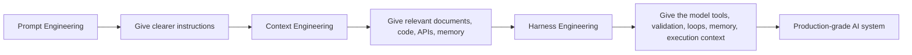
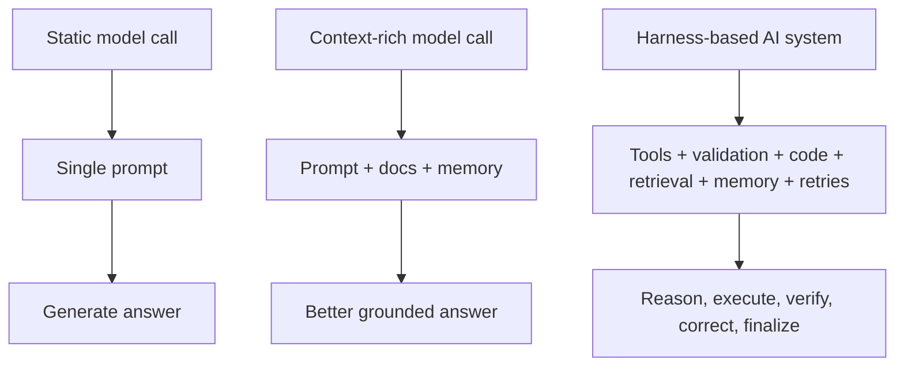
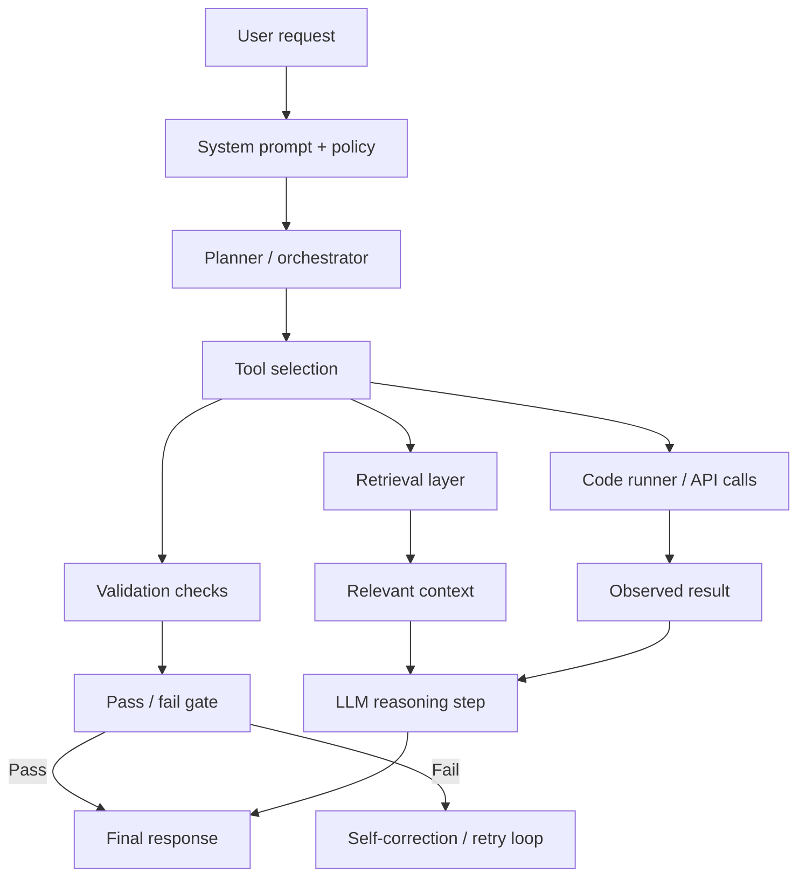

# 02 — Harness Engineering: The Shift from Prompting to AI 2.0

## Why this matters

We started with prompt engineering.

Then we moved to context engineering.

Now we are in the era of AI 2.0, where the decisive leap is not “better wording” or “bigger context.” The decisive leap is system design around the model.

This is the becoming of harness engineering.

In simple terms:

- Prompt engineering = better instructions.
- Context engineering = better memory and input.
- Harness engineering = better system behavior around the model.

And that is what makes AI useful in production, not just in demos.

---

## The evolution

---

## 1) Prompt engineering: better instructions

Prompt engineering was the first big unlock.

The idea was simple:

> If I tell the model better what I want, I get better output.

This was a breakthrough. It helped teams do things like:

- write better code,
- summarize documents,
- transform text,
- generate structured outputs,
- route intent to different tasks.

But this soon hit a limit.

A model can only follow a prompt as well as the environment around it allows.

If the task requires real-world verification, dynamic memory, domain-specific data, or grounded execution, then static instructions alone are not enough.

---

## 2) Context engineering: better memory and grounding

The next step was context engineering.

The insight was:

> The model needs the right context, not just the right wording.

This meant feeding it:

- project docs,
- API specs,
- codebases,
- database schemas,
- business rules,
- prior conversation state,
- retrieval results,
- relevant examples.

This was a meaningful improvement because the model gained more grounding.

But even this had limitations.

### The problem with context

Context can be:

- stale,
- noisy,
- too large to fit efficiently,
- irrelevant to the current task,
- expensive to include on every call,
- inconsistent across requests.

This creates a critical issue:

> The model is being forced to carry a large “fat instruction” for every request, even when most of it is not useful in that moment.

In other words, context engineering improved quality, but it also exposed a deeper issue: the model needs dynamic access to the right information at the right time, not just a giant static bundle every time.

---

## 3) Why prompt + context are not enough

The real production problem is not just “How do I ask better?”

The real production problem is:

> How do I build a system that gives the model the right tools, the right checks, the right memory, and the right execution loop?

A model alone is not an operating system.

A useful AI system must be able to:

- read inputs,
- inspect state,
- select tools,
- validate intermediate outputs,
- retry when something fails,
- call APIs or code runners,
- check logs,
- reason over results,
- revise the plan,
- and continue until the task is complete.

This is the core shift behind AI 2.0.

---

## The shift: from static answer generation to dynamic execution

Prompt engineering treats AI like a smart text generator.

Context engineering treats AI like a smart assistant with a memory pack.

Harness engineering treats AI like a dynamic operator inside a larger system.

---

## 4) What harness engineering actually means

Harness engineering is the practice of building an execution scaffold around the model.

The model is not left alone with a prompt and hope.

Instead, the system provides:

- tool access,
- code execution,
- API access,
- external data sources,
- logs and traces,
- validation checks,
- policy and guardrails,
- retry loops,
- state management,
- memory retrieval,
- human review boundaries.

This means the model can do more than generate a response. It can operate as part of a real workflow.

---

## The architecture of a harness

This is the real architecture of AI 2.0.

The model is connected to a runtime that can:

- inspect output,
- compare with requirements,
- call tools,
- revisit its reasoning,
- recover from failure,
- and continue until the result meets quality thresholds.

---

## 5) Why this is more production-ready

A harness engineering approach creates a more reliable AI system because it does not rely on one magical pass.

The system becomes a loop of:

1. observe the request,
2. gather the right context,
3. choose the correct tools,
4. execute,
5. validate the result,
6. correct or retry,
7. continue until stable outcome.

This is a big difference from:

> “send one prompt and hope the answer is correct.”

Instead, the system behaves more like a controlled agentic workflow.

---

## 6) The critical design idea: dynamic retrieval over static stuffing

One of the biggest mistakes in early AI systems was to stuff everything into the prompt.

That causes:

- token bloat,
- slower latency,
- irrelevant context,
- stale memory,
- unpredictability,
- degradation in quality.

Harness engineering fixes this by making knowledge dynamically retrievable.

This means:

- queries can fetch only the relevant documents,
- the model can call tools for fresh data,
- memory can be selectively injected,
- policy can be enforced by gates,
- code can be executed to verify correctness.

This is a much better match for production demand.

---

## 7) Guardrails and enforcement

A model alone cannot be trusted to stay within business constraints.

A harness can enforce constraints explicitly:

- allowed actions,
- restricted tools,
- rate limits,
- data access boundaries,
- output schema validation,
- risk policies,
- approval gates for sensitive operations,
- stop conditions for unsafe behavior.

This is the difference between an AI feature and an AI system that can be operated safely.

---

## 8) The feedback loop

The most important idea in harness engineering is that execution is iterative.

The system is not just:

> prompt → output

It is more like:

> request → reasoning → action → verification → correction → final result

This continuous loop creates:

- improved accuracy,
- reduced hallucination risk,
- better task completion,
- better operational control,
- lower human intervention over time.

---

## 9) Example: AI support assistant with a harness

Imagine an internal AI support assistant.

A naive prompt-only system might do this:

- read the user request,
- guess the answer,
- respond from memory,
- fail when the issue needs live context.

A harness-based system does this instead:

```mermaid
flowchart LR
    A[User asks: 'Why is API latency high?'] --> B[Planner]
    B --> C[Retrieve recent incidents and metrics]
    C --> D[Query logs / traces / dashboards]
    D --> E[Check error patterns and failed deploys]
    E --> F[Reason over evidence]
    F --> G[Propose root cause and remediation]
    G --> H[Validate with metrics and runbook]
    H --> I[Respond with evidence-based answer]
```

This is not just a smarter language model — it is a smarter operating loop.

---

## 10) Why this is the AI 2.0 mindset

AI 2.0 is not about language models becoming magically intelligent.

It is about building systems where the model becomes part of a reliable execution environment.

The real pattern is:

- prompt is the entry point,
- context is the memory layer,
- tools are the action layer,
- validation is the quality gate,
- feedback loops are the learning engine,
- orchestration is the system design layer.

That is how we go from a clever demo to a real-world AI product.

---

## Interview-ready summary

Prompt engineering was the first wave: improve the instruction. Context engineering was the second wave: provide better memory and grounding. But both are limited because static inputs can be stale, noisy, and bloated. Harness engineering is the next evolution: we build systems around the model so it can call tools, access relevant data, validate results, inspect logs, run code, retry on failure, enforce constraints, and iterate toward a correct outcome. This makes AI more accurate, more scalable, and much more production-ready than a single model call ever could be.

---

## One-line takeaway

> AI 2.0 is not about giving the model more words; it is about giving the model a working system around it.

**Day 02 complete.**
