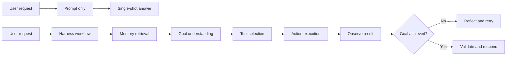
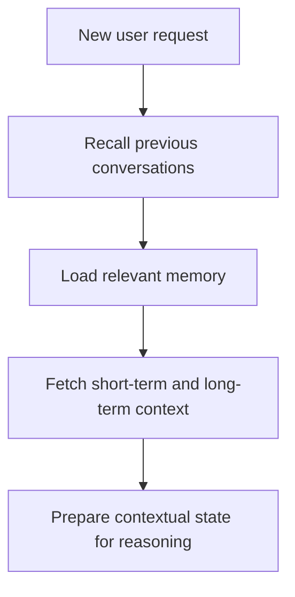
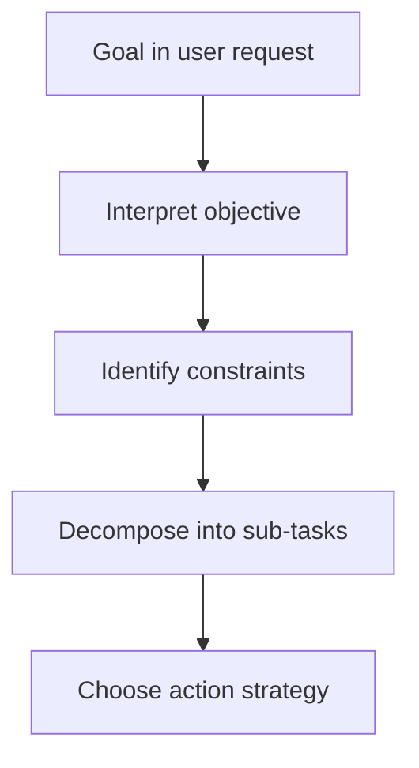
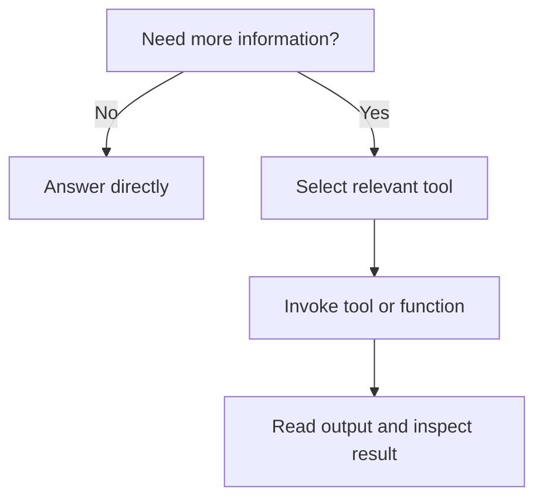
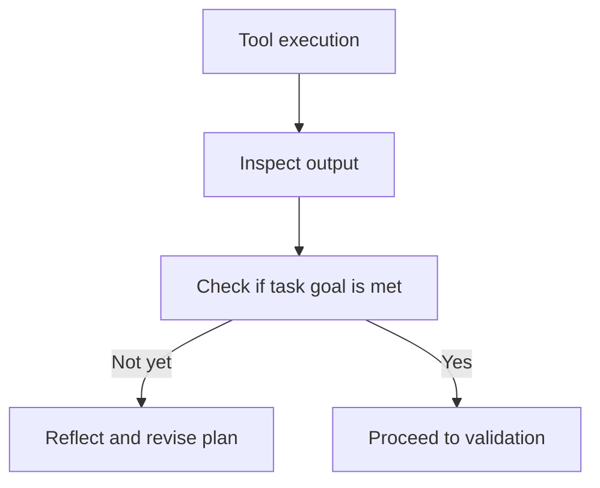
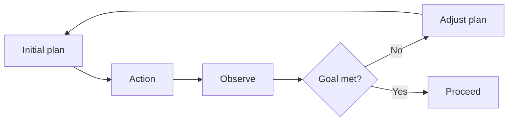
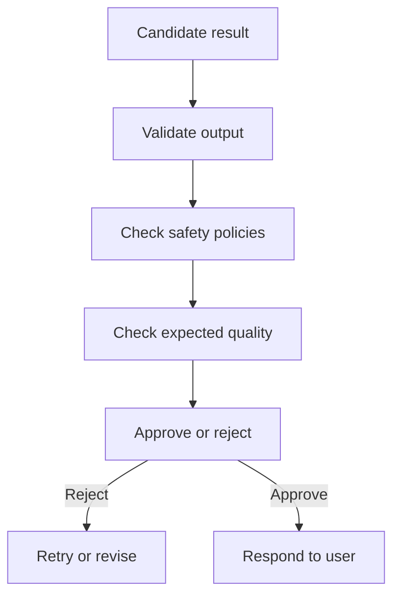

# Day 2 — Agent Workflow and Harness Design

## Why this matters

The future of AI is not just a better prompt. It is a better workflow.

The next generation of AI products are not simple chat interfaces. They are systems that can:

- remember earlier interactions,
- understand user goals,
- decide which tool to use,
- execute an action,
- inspect the result,
- reflect on failure,
- revise the plan,
- and only then respond.

This is the core of harness engineering.

A harness is not a single magic prompt. It is a structured environment that gives the agent the ability to think, act, observe, and improve.

That is why UI-driven workflows are becoming far more important than static prompt-only interactions.

---

## The big shift

The old model was:

> Ask the AI once, hope the answer is correct.

The new model is:

> Build a workflow around the AI so it can reason, act, validate, and recover.

---

## The agent workflow in a harness

When a user asks a question, a well-designed agent does not go straight to answer generation. It enters a structured lifecycle.

The workflow is roughly as follows:

1. retrieve relevant context from memory,
2. understand the goal,
3. break the task into smaller decisions,
4. decide whether a tool is required,
5. call that tool or function,
6. read the tool output,
7. evaluate whether the task is complete,
8. self-correct if needed,
9. validate safety and output quality,
10. respond to the user.

This is the real orchestration model behind modern AI systems.

---

## 1) Memory retrieval: access the relevant past context

The first step in a harness is not “generate a response.”

It is to check what the system already knows.

This can include:

- earlier conversations,
- agent memory,
- user preferences,
- relevant code or project state,
- previously stored facts,
- system instructions,
- prior tool outputs.

This is a crucial step because the model should not start from zero every time.

### Why this matters

Without good memory, the agent acts like a fresh model every time.

With memory, it can become context-aware, personalized, and more consistent over time.

But memory must be selective. Too much irrelevant context creates noise, latency, and confusion.

---

## 2) Goal understanding: what are we actually trying to do?

Once relevant history is loaded, the agent needs to understand the objective.

This is not just parsing the user request. It is deeper:

- What is the real goal?
- What are the constraints?
- What counts as success?
- What is the expected output format?
- What does “done” look like?

This stage is often where the agent decides how to break the problem down into smaller pieces.

### The important idea

A good agent does not blindly answer. It forms a plan.

This is the difference between a conversational bot and an execution engine.

---

## 3) Decision time: do I need a tool?

Once the goal is understood, the agent asks an important question:

> Do I have enough information to answer without external help?

Sometimes the answer is yes.

Sometimes the answer is no.

If the answer is no, the agent transitions into tool use.

This is where a harness becomes powerful.

The agent is not limited to internal reasoning. It can use a wide catalog of capabilities:

- search the codebase,
- fetch a relevant document,
- call an API,
- run a shell command,
- query a database,
- inspect logs,
- execute code,
- trigger a workflow,
- read telemetry,
- validate a calculation,
- transform data.

This is the core difference between a prompt-only system and a tool-driven system.

---

## 4) Action step: invoking tools and functions

Once the agent decides it needs external information, it chooses the most suitable tool.

This is not random. A good harness provides a structured tool layer, and the agent selects the best tool based on the task.

Examples of tool categories include:

- search tools,
- retrieval tools,
- code executors,
- API clients,
- database query tools,
- validation and linting tools,
- workflow triggers,
- observability tools,
- scheduler or queue clients.

The key design principle is:

> The model should act like a planner, not like a manual task runner.

The tool layer gives it external execution power.

---

## 5) Observation and self-retrospection

After the tool runs, the agent reads the output carefully.

This is the observation step.

The model asks:

- Did the tool return what I expected?
- Is the result complete?
- Is there an error or partial failure?
- Did I actually solve the problem?
- Do I need to adjust my plan?

This is a crucial phase of agent design because it moves the model from blind action to reflective action.

This is where the system starts looking like an engineer rather than just a generator.

---

## 6) Self-correction loop

If the result is not correct, the agent does not just stop. It loops.

This is often described as a closed-loop reasoning pattern.

The system does this:

- identify missing info,
- adjust the approach,
- choose another tool if necessary,
- run the next step,
- observe again,
- repeat until the goal is achieved or the system decides to stop.

This is the essence of a real agentic workflow.

### Why this matters

This loop is what makes AI systems robust.

Without it, a single wrong output can become a final answer.

With it, the system becomes resilient, iterative, and much closer to production behavior.

---

## 7) Validation: safety, accuracy, and policy enforcement

Once the model reaches a candidate result, the system does not just deliver it immediately.

It validates it.

Validation can include:

- checking whether the answer matches the user intent,
- checking business policy constraints,
- verifying if required fields are present,
- inspecting if a tool output is complete and correct,
- validating that the system did not violate any safe-use policies,
- running guardrail rules,
- verifying if the response is safe and relevant.

This is the step where the agent transforms from “creative text generator” to “responsible execution system.”

---

## 8) Final response generation

Only after the plan, action, correction loop, and validation pass does the system emit the final response.

This final answer should be based on evidence, not just probability.

That means the user gets:

- the actual result,
- the evidence used,
- a final answer shaped by validation,
- and a system that is much more trustworthy than a one-shot prompt.

---

## The real harness mindset

The real idea behind harness engineering is simple:

> The model should not act alone. It should work inside a system that lets it plan, act, observe, revise, validate, and finish correctly.

A harness gives the agent:

- context,
- memory,
- tools,
- validation,
- control loops,
- retries,
- governance,
- and feedback.

That is what makes it powerful.

---

## Why UI workflows are becoming central

Modern AI experiences increasingly live in a UI workflow, not just a chat box.

The user is not just asking a single question. They are:

- uploading files,
- choosing a task,
- selecting from options,
- triggering workflows,
- reviewing intermediate outputs,
- approving or rejecting steps,
- refining the process.

This is why UI-driven AI workflows are becoming the dominant design pattern.

It allows the system to convert an abstract prompt into a real execution flow.

---

## Interview-ready summary

In harness engineering, the agent does not simply answer a question. It follows a workflow: retrieve memory, understand the goal, decide whether tools are needed, invoke those tools, observe the output, reflect on whether the objective has been achieved, retry when necessary, validate safety and quality, and finally respond with a verified result. This loop is what makes AI systems more accurate, more resilient, and more production-ready than prompt-only designs. In other words, UI workflows and harness design are becoming the real operating model for AI 2.0.

---

## One-line takeaway

> The agent becomes powerful not because it can guess better, but because it can think, act, observe, and correct inside a structured system.

**Day 2 complete.**
