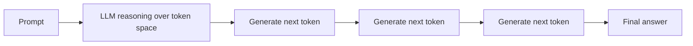
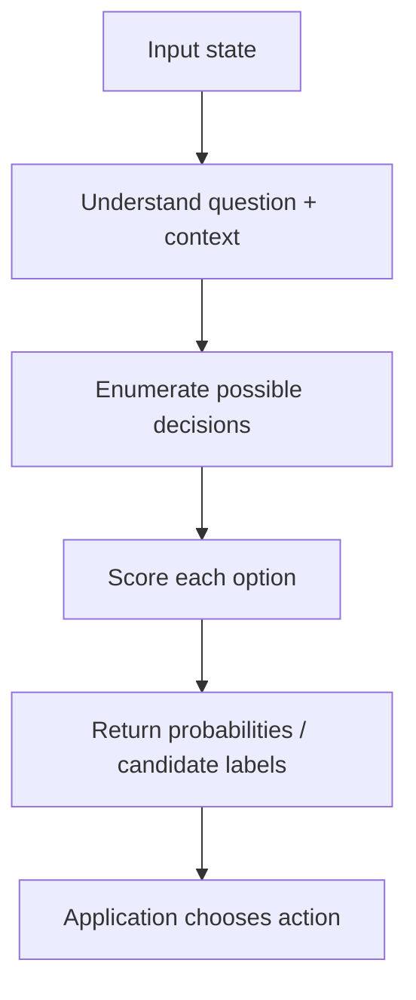
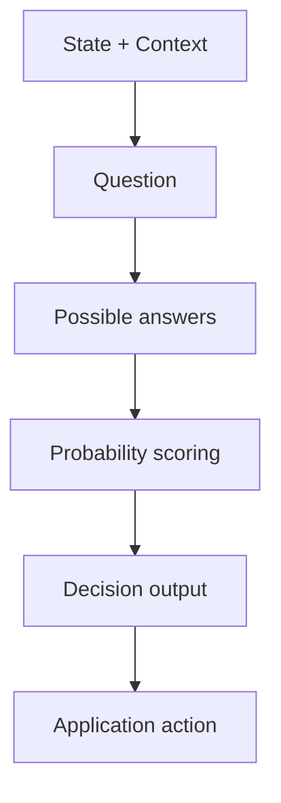
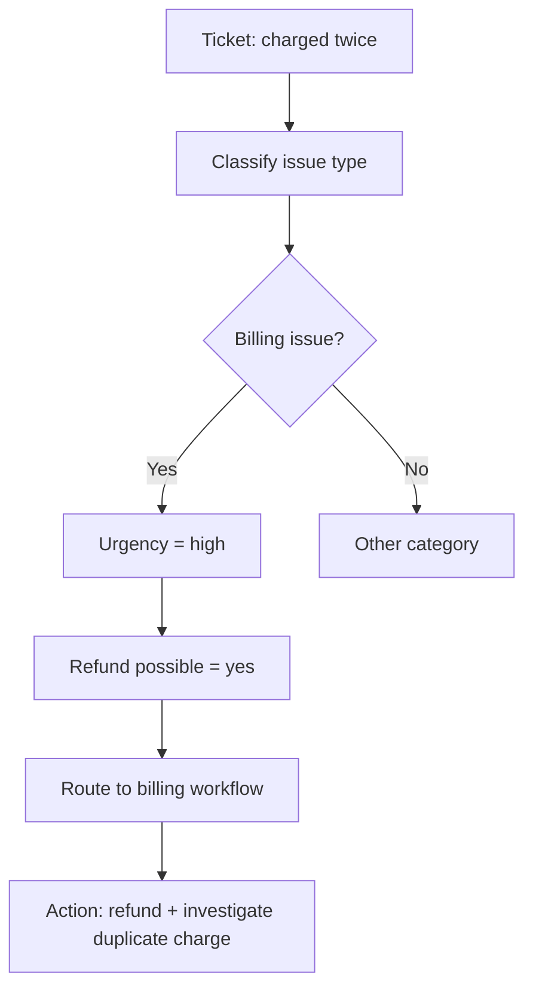

# Day 3 — The Probabilistic Decision Engine: Why "Jeff" Is the Cheap, Fast AI Layer

## Why this matters

AI enthusiasts talk a lot about large language models, but not everyone understands the real architectural shift happening beneath the hype.

The key idea is this:

Not every AI problem needs a full generative model pass.

Sometimes, the problem is not to write a paragraph. The problem is to classify, route, score, or decide.

That is where a probabilistic decision engine can be far more valuable than a traditional LLM call.

This is the idea behind what the transcript calls **"Jeff"** — a lightweight probabilistic decision layer that evaluates a state, scores possible outcomes, and selects the most likely one with extremely low compute cost.

---

## The core idea

A traditional LLM is optimized for open-ended generation.

It takes a prompt, considers a huge space of possible continuations, and produces a sequence of tokens.

This is expensive because generation is fundamentally sequential and token-heavy.

A probabilistic decision engine works differently.

It does not generate a long answer from scratch. It evaluates a state and a set of candidate options, then outputs the most likely classification or action.

In other words:

> Instead of generating words, it chooses the most likely category, state, or decision.

That is a much smaller, cheaper, and faster problem.

---

## 1) Traditional LLMs: expensive for simple decisions

A traditional model follows this pattern:



This is powerful, but it has costs:

- token consumption is high,
- latency can be high,
- memory use can grow with context,
- the system pays for every token generated,
- many tasks do not need full free-form generation.

A customer support ticket is a great example.

The real need is not to write a long essay. The real need is to decide:

- what category is this ticket?
- how urgent is it?
- should it be escalated?
- is it refundable?
- is it a billing problem or a product issue?

That is a classification and routing problem, not a full writing problem.

---

## 2) Jeff-style design: evaluate state, not generate prose

The Jeff-style engine models the problem differently.

It looks like a decision pipeline:



This is closer to a probabilistic decision tree or a small classification model.

It takes:

- current context,
- the question or task,
- a set of possible answers,
- and scores each option based on likelihood.

The result is not one long prose answer. It is often something like:

```json
{
  "category": "billing_error",
  "confidence": 0.94,
  "urgency": "high",
  "refund_possible": true,
  "recommended_action": "escalate_to_finance"
}
```

This is a much smaller decision problem than open-ended generation.

---

## 3) Why this is dramatically cheaper

The transcript emphasizes a key point: the Jeff-style workflow can be **orders of magnitude cheaper** than a normal LLM pass.

Why?

### A. It does not generate full text

Generating tokens is the expensive part.

A classifier or decision engine can often be implemented as:

- a small model,
- a rules engine,
- a short prompt to a lightweight model,
- or a deterministic state machine with probability scoring.

### B. It narrows the action space

Instead of exploring the full next-token universe, it only evaluates a finite set of likely outcomes.

That reduces compute and latency sharply.

### C. It is optimized for routing and decisions

Real systems often do not need an open-ended answer. They need a decision.

That decision is often 10x easier to compute than generating a rich explanation.

---

## 4) The anatomy of a Jeff-style decision engine

A good way to think about it is:

- **State** — the current situation or context
- **Question** — what problem is being solved
- **Candidate answers** — possible outcomes or routes
- **Probability model** — how likely each answer is
- **Decision layer** — what the application does next



This is a very elegant model because the system is designed to separate:

- understanding context,
- evaluating options,
- selecting a route,
- taking action.

That is not exactly how a general LLM answers a free-form question, but it is much closer to how operational systems actually work.

---

## 5) Why this is a decision tree, not just a prompt

The transcript uses the phrase “probabilistic decision tree.” That is an important framing.

A decision tree is not just a set of if-else statements. It is a model that chooses among branches based on evidence.

In an AI system, the decision tree may be:

- a small classifier,
- a rules + probability model,
- a domain-specific router,
- a finite-state workflow,
- or a compact model that chooses between a set of valid actions.

The key property is this:

> It can turn a vague problem into a finite set of high-confidence possibilities.

That makes it ideal for systems like:

- customer support triage,
- routing tickets,
- intent detection,
- fraud scoring,
- approval workflows,
- policy compliance checks,
- order issue classification,
- incident severity detection.

---

## 6) Example: customer support ticket triage

Imagine a support system receives a complaint:

> I was charged twice for my order.

A traditional LLM might generate a long answer describing what to do.

A Jeff-style engine instead evaluates the context and produces a structured decision.



This is a powerful pattern because the system does not need to write a narrative. It needs to route the case correctly.

A traditional model may take longer and cost more while producing a result that still needs a downstream decisioning layer.

The Jeff-style model returns structured output that the application can act on immediately.

---

## 7) The runtime behavior: state, question, options, score

A Jeff-style decision engine can be represented as a state machine:


This architecture is especially useful when the system needs to make a decision quickly and cheaply in real time.

Examples:

- select the likely issue category,
- decide if the operation is safe,
- select the best product recommendation,
- determine the likely user intent,
- decide whether the request is allowed,
- flag suspicious behavior,
- assign queue priority,
- route to the correct workflow.

---

## 8) Why this matters for AI engineering

This is not just a clever trick. It is a design principle.

The big lesson is:

> Do not use a powerful generative model for every task.

Use the right model or decision layer for the right job.

That means:

- use LLMs for reasoning, synthesis, and open-ended language tasks,
- use decision engines for classification, routing, scoring, and structured prediction,
- use deterministic logic when rules are clear,
- use generative systems when nuance and language matter.

This is how high-performing AI systems scale.

---

## 9) The real value of a probabilistic decision layer

The transcript highlights the speed and cost advantage.

It is not just about saving money. It is about building systems that are:

- faster,
- cheaper,
- easier to reason about,
- easier to control,
- easier to audit,
- easier to route to the right downstream service.

This is especially important when you are building product systems with thousands or millions of decisions per day.

At that scale, a cheaper and faster classification layer can be more valuable than one big expensive LLM call.

---

## Interview-ready summary

Jeff is best understood as a probabilistic decision engine rather than a full generative model. Instead of generating a long answer token by token, it evaluates the current state, the question, and multiple candidate outcomes, then scores each option by likelihood. This makes it dramatically cheaper and faster than a traditional LLM, especially for tasks like classification, routing, and action selection. In production systems, that means you can use a lightweight decision layer to detect intent, triage issues, decide urgency, and route work to the right workflow without paying the cost of a full generative pass. In short, Jeff is a decision-first AI architecture optimized for speed, cost, and operational control.

---

## One-line takeaway

> The best AI system is not always the most expressive one — it is the one that chooses the correct level of intelligence for the task.

**Day 3 complete.**
